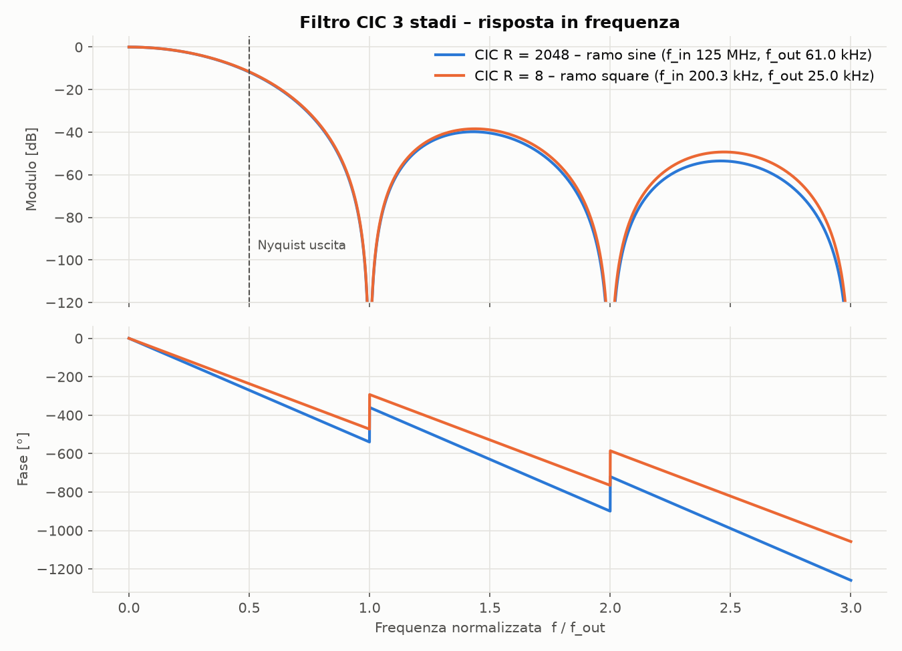
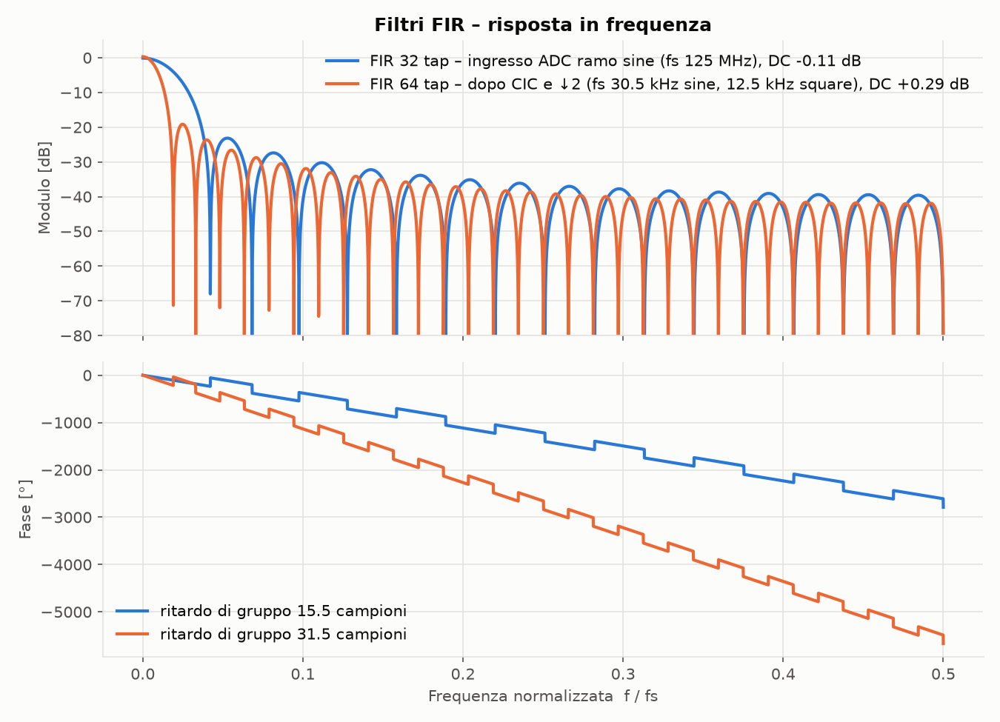

# FPGA FOG – open loop 200 kHz (Red Pitaya)

Elettronica di demodulazione open-loop per giroscopio a fibra ottica (FOG) su
**Red Pitaya STEMlab 125-14** (Zynq-7020, `xc7z020clg400-1`), con ADC/DAC a 14 bit
e clock di campionamento a 125 MHz.

Il repository contiene solo i sorgenti: il progetto Vivado si rigenera con uno script Tcl.

## Design

Nel progetto ci sono due block design, entrambi con acquisizione via AXI DMA verso la DDR del PS.

### `open_loop_200KHz` – modulazione sinusoidale, demodulazione I/Q

```
DDS seno ──► DAC
ADC B ─► FIR 32 tap ─► splitter ─┬─► × DDS (0°)  ─┐
                                 └─► × DDS (90°) ─┴─► mux I/Q ─► CIC R=2048 ─► ↓2 ─► FIR 64 tap ─► ↓100 ─► TLAST ─► DMA
```

- Frequenza: `phase_step` (costante `xlconstant_0`) → f = phase_step · 125 MHz / 2³².
  Nel BD è impostato **6800000 → 197.9 kHz**; per 200 kHz esatti serve **6871948**.
- Fase del seno sul DAC e selezione I/Q dalla `axi_gpio_0` (`gpio_o`).
- Uscita al DMA: 125 MHz / 2048 / 2 / 100 ≈ **305 Hz**.

### `open_loop_200KHz_square` – modulazione a onda quadra

```
Square wave (312+312 cicli) ──► DAC
ADC B ─► demodulatore (Σ semiperiodo 1 − Σ semiperiodo 2) ─► CIC R=8 ─► ↓2 ─► FIR 64 tap ─► ↓50 ─► TLAST ─► DMA
```

- Periodo 624 cicli → 200.32 kHz.
- Il demodulatore integra tutti i campioni di ogni semiperiodo; parametri:
  `PHASE_DELAY` (ritardo DAC→fibra→ADC in campioni) e `BLANK` (campioni scartati dopo ogni fronte).
- Uscita al DMA: 200.32 kHz / 8 / 2 / 50 ≈ **250 Hz**.

In entrambi i design il frame DMA è di 68000 campioni (`TLAST`).

### Risposta dei filtri

Generate da `docs/plot_filters.py` (i coefficienti FIR sono letti da `rtl/`).





## Struttura

```
rtl/      moduli RTL (module reference dei block design), un file per modulo
bd/       block design esportati con write_bd_tcl
constr/   vincoli Red Pitaya (pin e clock)
mem/      LUT del seno + gen_lut.py per rigenerarle
sim/      testbench
docs/     grafici della risposta dei filtri + script per rigenerarli
build_project.tcl   crea il progetto Vivado in vivado/
export_bd.tcl       riesporta i block design in bd/ dopo una modifica
```

## Requisiti

- Vivado **2025.2** (gli IP Xilinx sono esportati senza versione, quindi versioni vicine dovrebbero funzionare)
- Python 3 (solo per rigenerare le LUT)

## Come rigenerare il progetto

Dalla Tcl console di Vivado (senza progetti aperti):

```tcl
cd <percorso del repository>
source build_project.tcl
```

Il progetto viene creato in `vivado/` (ignorata da git) con top `open_loop_200KHz_square_wrapper`.
Per usare il design sinusoidale cambiare `top_wrapper` in testa a `build_project.tcl`.

> Su Windows Vivado non gestisce percorsi oltre 260 caratteri: clonare il repository in un
> percorso corto (es. `C:/fpga/...`).

## Workflow di modifica

1. Modificare RTL in `rtl/` e/o i block design nel progetto aperto.
2. Se sono cambiati i block design: `source export_bd.tcl` (riscrive `bd/*.tcl`).
3. Commit di `rtl/`, `bd/`, ecc. La cartella `vivado/` non va mai versionata.

## LUT del seno

`mem/lut_sin.mem`: 2048 campioni su un periodo, ampiezza ±4000, 16 bit in complemento a 2,
letta da `Axis_dds_sine_2048` con `$readmemh`. La frequenza non dipende dalla LUT ma da `phase_step`.
`mem/lut_sin_200k_625.mem`: un periodo esatto a 200 kHz con clock 125 MHz (625 campioni),
per un eventuale generatore a lettura diretta.

```
python mem/gen_lut.py
```

## Simulazione

`sim/tb_square.v` verifica la catena onda quadra → canale (ritardo, guadagno, offset) →
demodulatore → CIC, confrontando l'uscita col valore atteso. Nel progetto è il top di `sim_1`:
*Run Simulation → Run Behavioral Simulation*, poi `run all`. Deve stampare `errori: 0`.

## Limiti noti

- Il mux I/Q acquisisce I **oppure** Q: non si possono avere entrambi in contemporanea.
- I blocchi AXI-Stream custom non gestiscono davvero il backpressure (funzionano perché lo stream è continuo);
  se il DMA non è pronto i campioni vengono persi.
- `Add_tlast_tkeep`: `tready` registrato e `tkeep` a 8 bit su bus a 32 bit.
